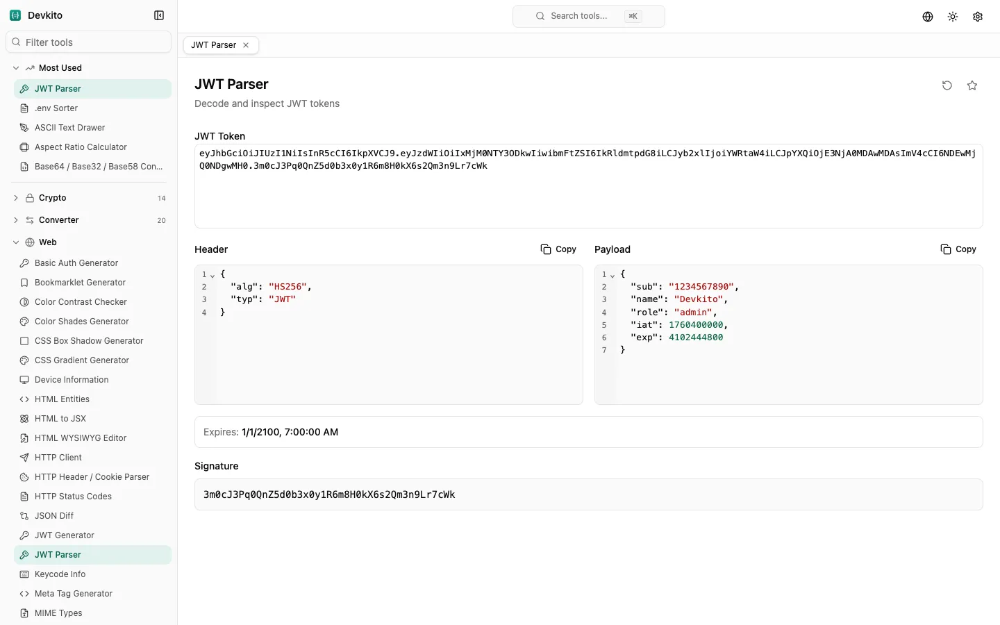
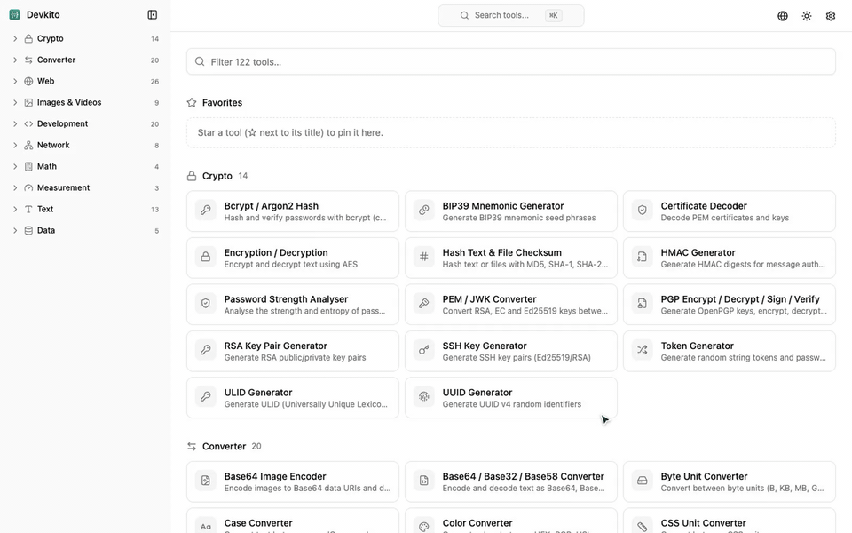
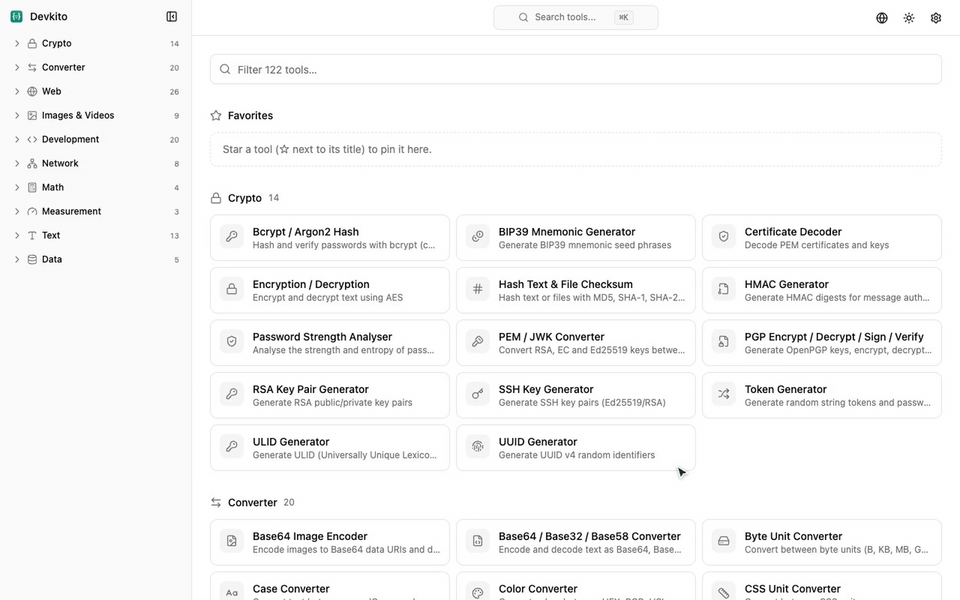
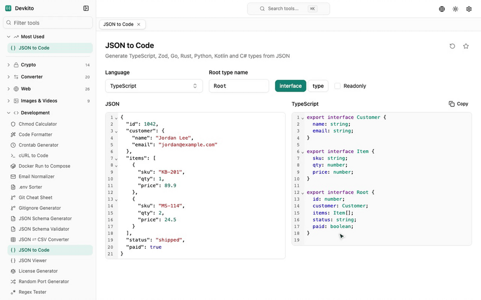
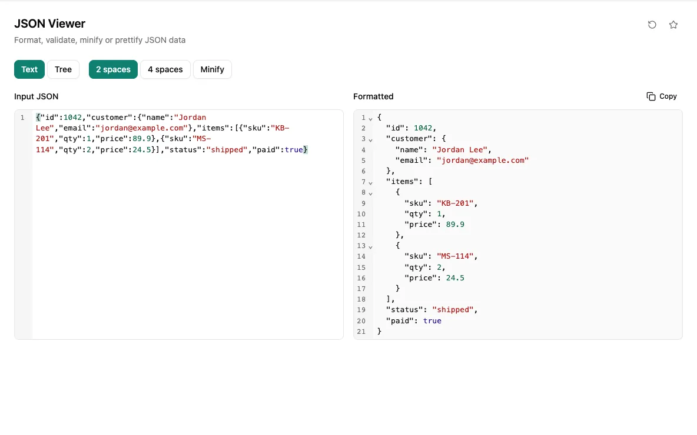
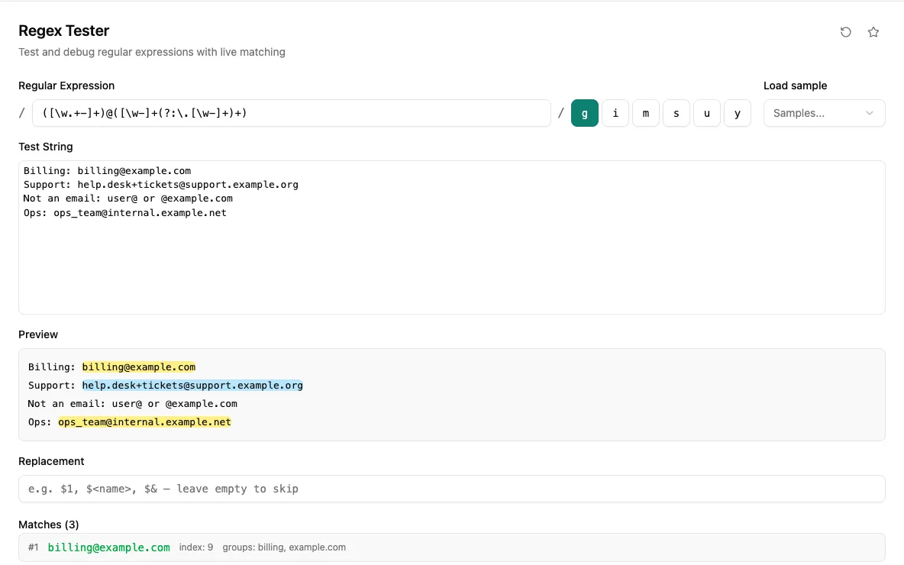
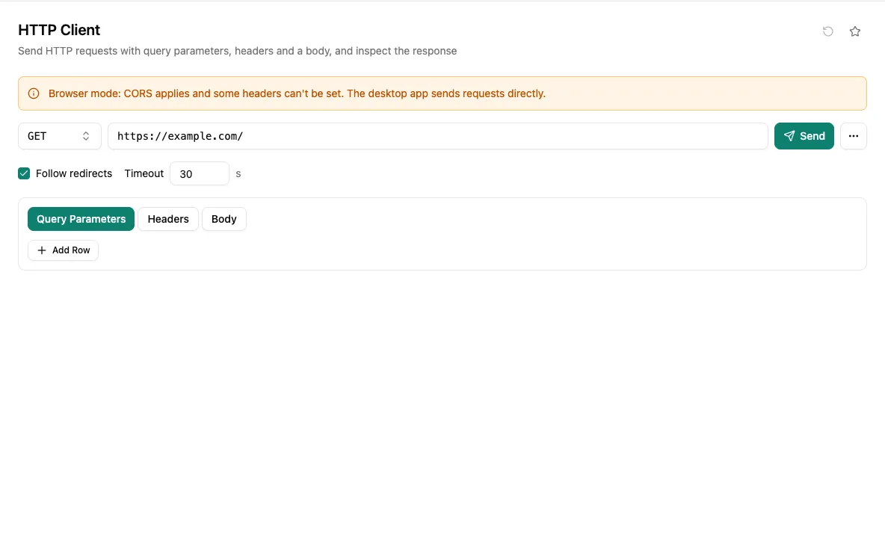
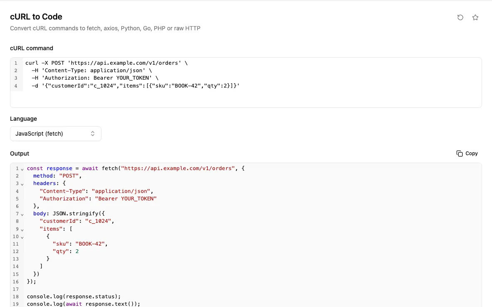
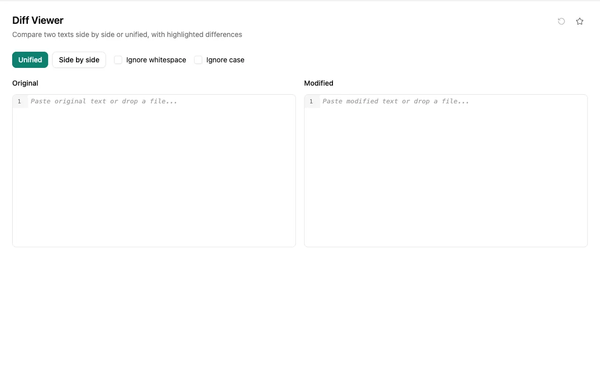
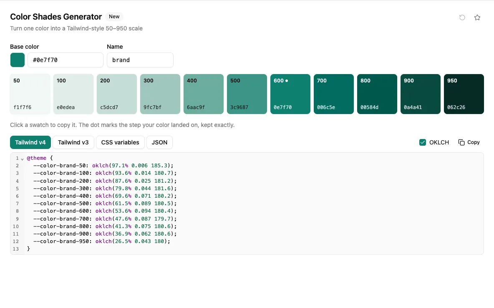

# Devkito

**Every small dev tool you keep googling, in one app.**

122 formatters, encoders, converters, generators and network checks behind one shortcut. 
They run on your machine, so they work offline and what you paste stays with you.

[**Download**](https://devkito.com/download) · [Website](https://devkito.com) · [All tools](https://devkito.com/tools) · [Changelog](https://devkito.com/changelog) · [Pricing](https://devkito.com/pricing)

macOS (Apple silicon and Intel) · Windows 10/11 · Linux (AppImage, .deb, .rpm)

 

## Why Devkito

- **Your data stays on your machine.** Tokens, keys and customer data never go through someone else's website. Network tools only contact the host you point them at.
- **One shortcut away.** Press <kbd>⌥</kbd><kbd>⌘</kbd><kbd>K</kbd> (<kbd>Ctrl</kbd><kbd>Alt</kbd><kbd>K</kbd> on Windows and Linux) from any app to bring Devkito forward with search open. <kbd>⌘</kbd><kbd>↵</kbd> runs a tool, <kbd>⇧</kbd><kbd>⌘</kbd><kbd>C</kbd> copies the result.
- **Paste first, pick the tool later.** Paste a JWT, JSON, URL or cron line and Devkito recognises it and opens the tool that reads it, already filled in.
- **Picks up where you left off.** Inputs, favourites and recent tools are remembered between sessions, and settings can be exported to another machine.
- **A real desktop app.** Native window, tray icon, light and dark themes, English and Vietnamese, and automatic updates.

## See it in action

<table>
  <tr>
    <td width="50%">
      
      
<b>Paste into search, get the right tool.</b> Put a token, JSON, URL or cron line into <kbd>⌘</kbd><kbd>K</kbd> and Devkito suggests the tool that reads it.

    </td>
    <td width="50%">
      
      
<b>Find any tool in a few keystrokes.</b> Type part of a name and press Enter. Output updates as you type, with no Convert button.

    </td>
  </tr>
  <tr>
    <td width="50%">
      
      
<b>Paste without choosing a tool.</b> Devkito recognises what you copied and offers to open it in the matching tool.

    </td>
    <td width="50%">
      
      
<b>Light or dark, English or Vietnamese.</b> Switch from the toolbar; Devkito remembers your choice.

    </td>
  </tr>
</table>

## A few of the tools

<table>
  <tr>
    <td width="50%">
JSON Viewer
</td>
    <td width="50%">
Regex Tester
</td>
  </tr>
  <tr>
    <td width="50%">
HTTP Client
</td>
    <td width="50%">
cURL to Code
</td>
  </tr>
  <tr>
    <td width="50%">
Diff Viewer
</td>
    <td width="50%">
Color Shades Generator
</td>
  </tr>
</table>

## What's inside

122 tools in 10 groups. Each one has its own page on [devkito.com/tools](https://devkito.com/tools).

<b>Development</b> (20)

Chmod Calculator, Code Formatter, Crontab Generator, cURL to Code, Docker Run to Compose, Email Normalizer, .env Sorter, Git Cheat Sheet, Gitignore Generator, JSON Schema Generator, JSON Schema Validator, JSON ⇄ CSV Converter, JSON to Code, JSON Viewer, License Generator, Random Port Generator, Regex Tester, Semver Checker, SQL Prettify, XML Formatter

<b>Web</b> (26)

Basic Auth Generator, Bookmarklet Generator, Color Contrast Checker, Color Shades Generator, CSS Box Shadow Generator, CSS Gradient Generator, Device Information, HTML Entities, HTML to JSX, HTML WYSIWYG Editor, HTTP Client, HTTP Header / Cookie Parser, HTTP Status Codes, JSON Diff, JWT Generator, JWT Parser, Keycode Info, Meta Tag Generator, MIME Types, OTP Code Generator, Safelink Decoder, Slugify String, Tailwind CSS Converter, URL Encoder/Decoder, URL Parser, User Agent Parser

<b>Converter</b> (20)

Base64 Image Encoder, Base64 / Base32 / Base58 Converter, Byte Unit Converter, Case Converter, Color Converter, CSS Unit Converter, Gzip / Brotli Compressor, Integer Base Converter, List Converter, Markdown ⇄ HTML Converter, MessagePack / CBOR Decoder, Roman Numeral Converter, Text to Binary, Text to NATO Alphabet, Text to Unicode, Timestamp Diff, Timezone Converter, TOML / YAML / JSON Converter, Unix Timestamp Converter, XML / JSON Converter

<b>Crypto</b> (14)

Bcrypt / Argon2 Hash, BIP39 Mnemonic Generator, Certificate Decoder, Encryption / Decryption, Hash Text & File Checksum, HMAC Generator, Password Strength Analyser, PEM / JWK Converter, PGP Encrypt / Decrypt / Sign / Verify, RSA Key Pair Generator, SSH Key Generator, Token Generator, ULID Generator, UUID Generator

<b>Text</b> (13)

ASCII Text Drawer, Diff Viewer, Emoji Picker, Line Tools, Lorem Ipsum Generator, Markdown Table Generator, Numeronym Generator, Regex Library, String Escape / Unescape, String Obfuscator, String Similarity, Text Statistics, Unicode Inspector

<b>Images & Videos</b> (9)

EXIF Viewer & Remover, Favicon Generator, Image Compressor, Image Format Converter, Image Generator, QR Code Generator, QR Code Reader, SVG Optimizer, SVG Placeholder Generator

<b>Network</b> (8)

CIDR Matcher, DNS Lookup & WHOIS, IPv4 Address Converter, IPv4 Range Expander, IPv4 Subnet Calculator, IPv6 ULA Generator, MAC Address Generator, TLS / SSL Checker

<b>Data</b> (5)

CSV Viewer / Editor, IBAN Validator, JSON Expression Eval, Mock Data Generator, Phone Parser

<b>Math</b> (4) and <b>Measurement</b> (3)

Aspect Ratio Calculator, ETA Calculator, Math Evaluator, Percentage Calculator, Benchmark Builder, Chronometer, Temperature Converter

## Install

Get the installer for your system from [devkito.com/download](https://devkito.com/download) or the [latest release](https://github.com/Devkito-HQ/devkito/releases/latest).

| System | File |
| --- | --- |
| macOS, Apple silicon | `Devkito_<version>_aarch64.dmg` |
| macOS, Intel | `Devkito_<version>_x64.dmg` |
| Windows 10/11, 64-bit | `Devkito_<version>_x64-setup.exe` |
| Linux | `.AppImage`, `.deb` (Debian, Ubuntu) or `.rpm` (Fedora, RHEL) |

The installers are not code-signed yet, so your system asks before opening Devkito the first time:

- **macOS:** right-click Devkito in Applications and choose **Open**, then **Open** again. If macOS says the app is damaged, run `xattr -cr /Applications/Devkito.app` and try again.
- **Windows:** when SmartScreen appears, click **More info**, then **Run anyway**.
- **Linux (AppImage):** `chmod +x Devkito_*.AppImage`, then run it.

After that, Devkito updates itself: it checks this repository for new releases and asks before installing one.

## Pricing

Try every tool free for 7 days, with no account or card. After that, a one-time licence keeps Devkito working forever and includes a year of updates:

| Computers | Price |
| --- | --- |
| 1 | $10 |
| 2 | $15 |
| 5 | $30 |

Buy on [devkito.com/pricing](https://devkito.com/pricing). Move a licence to another computer from Settings whenever you need.

## Privacy

Every tool except the network ones (DNS, WHOIS, TLS and HTTP requests) runs entirely on your machine. Devkito only goes online for licence checks, update checks and, if you leave them on, anonymous crash reports, which never include what you type into tools. Details in the [privacy policy](https://devkito.com/privacy).

## Feedback and support

- Found a bug or want a tool Devkito doesn't have? [Open an issue](https://github.com/Devkito-HQ/devkito/issues).
- Licence and billing questions: [support@devkito.com](mailto:support@devkito.com).

Including your Devkito version (Settings) and your operating system helps us answer faster.

---

This repository hosts Devkito's releases and issue tracker. The app's source code is not public.
